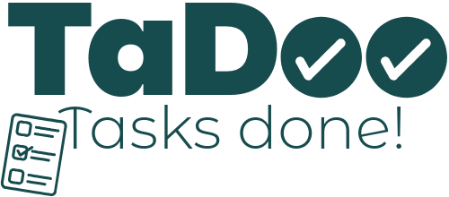

<!-- PROJECT TITLE -->
<br/>
<div align="center">
  
  <br/>
  <h1 align="center">TaDoo - Task Management Made Easy!</h1>
</div>


<!-- TABLE OF CONTENTS -->
<div>
  <details>
    <summary>Table of Contents</summary>
    <ol>
      <li>
        <a href="#-about-the-project">About The Project</a>
        <ul>
          <li>
            <a href="#features">Features</a>
          </li>
        </ul>
      </li>
      <li>
        <a href="#-technologies-used">Technologies Used</a>
      </li>
      <li>
        <a href="#-getting-started">Getting Started</a>
        <ul>
          <li>
            <a href="#prerequisites">Prerequisites</a>
          </li>
          <li>
            <a href="#installation">Installation</a>
          </li>
        </ul>
      </li>
      <li>
        <a href="#-running-the-app">Running the App</a>
      </li>
      <li>
        <a href="#-project-structure">Project Structure</a>
      </li>
      <li>
        <a href="#-usage">Usage</a>
      </li>
      <li>
        <a href="#-contributing">Contributing</a>
      </li>
      <li>
        <a href="#-license">License</a>
      </li>
    </ol>
  </details>
</div>

<br/>

<!-- ABOUT SECTION -->
## 💭 About The Project

**TaDoo** is a flexible and intuitive to-do application designed to organize and prioritize your tasks across various boards, task lists, and tasks.
Whether you’re managing a day-to-day activities, personal or academic goals, TaDoo keeps everything organized in a way that works for you.

### Features

- **Boards:** Organize your tasks into separate boards based on different projects or categories.
- **Task Lists:** Each board contains task lists where you can group tasks.
- **Tasks with Labels:** Tasks can be created with descriptive labels indicating priority.
- **Calendar View:** Aside from your personal boards, you can check your calendar for upcoming deadlines.
- **Task Management:** Tasks can be marked as complete, deleted, or moved between lists.
- **Responsive UI:** The application provides a clean, user-friendly interface with drag-and-drop functionality.

### Team Members

- Neo Xander Kirbiš
- Gal Petelin
- Ena Imamović

<br/>

<!-- TECHNOLOGIES SECTION -->
## 🔧 Technologies Used

[![Spring Boot][Spring-boot]][Spring-boot-url]
[![Preact][Preact]][Preact-url]
[![TypeScript][TypeScript]][TypeScript-url]
[![Tailwind CSS][Tailwind]][Tailwind-url]

<br/>

<!-- GETTING STARTED SECTION -->
## 📌 Getting Started

To get a local copy up and running, follow these simple steps.

### Prerequisites

Ensure you have the following installed:

- **Java 17** or higher
- **Maven** for building the backend
- **Node.js** (version 14 or higher recommended) + **npm** for the frontend
- **Working MySQL Database** (To setup the database you can run `database/schema.sql`)

### Installation

1. **Cloning the repository**

    ```bash
        git clone https://github.com/neoxk/TaDoo.git
        cd TaDoo
    ```

2. **Backend Setup**

   - Edit `src/main/resources/application.properties` to point to your MySQL database
  
   - Navigate to the backend directory:

    ```bash
      cd backend
    ```

   - Build the backend:

    ```bash
      mvn clean install
    ```

2. **Frontend Setup**

   - Navigate to the frontend directory:

    ```bash
      cd frontend
    ```

   - Install frontend dependencies:

   ```bash
      npm install
    ```

3. **Environment Variables**

   - Configure any necessary environment variables for both backend and frontend, such as database URL and server port settings in the `application.properties` file.

<br/>

<!-- RUNNING THE APP SECTION -->
## 💡 Running the App

1. **Running the Backend**

   - Navigate to the backend directory:

    ```bash
      cd backend
    ```

   - Start the backend (or run the application if you are using an IDE like IntelliJ: `Shift + F10`):

    ```bash
      mvn spring-boot:run
    ```

2. **Running the Frontend**

   - Navigate to the frontend directory:

    ```bash
      cd frontend
    ```

   - Start the frontend development server:

    ```bash
      npm run dev
    ```
    
<br/>

<!-- PROJECT STRUCTURE SECTION -->
## 📦 Project Structure

Below is an overview of the project structure.

```plaintext
.
├── backend                                         # Backend project root
│   ├── src                                         # Source files for the backend
│   │   ├── main                                    # Main application source code
│   │   │   ├── java/si/feri/ris/kirbis/todo        # Java package structure
│   │   │   │   ├── controllers                     # Controllers for handling HTTP requests
│   │   │   │   ├── entities                        # Entity classes representing database tables
│   │   │   │   ├── repositories                    # Interfaces for data persistence
│   │   │   │   ├── services                        # Business logic and service classes
│   │   │   │   └── TodoApplication.java            # Main class for Spring Boot application
│   │   │   └── resources                           # Configuration files
│   │   └── test/java/si/feri/ris/kirbis/todo       # Unit and integration tests
│   ├── mvnw                                        # Maven wrapper script for Unix-based systems
│   ├── mvnw.cmd                                    # Maven wrapper script for Windows
│   └── pom.xml                                     # Maven Project Object Model configuration file (Spring Boot dependencies)
├── database                                        # Database files
├── docs                                            # Project documentation and design files
├── frontend                                        # Frontend project root
│   ├── public                                      # Static assets
│   │   └── ...                                     # Additional public assets
│   ├── src                                         # Source files for the frontend
│   │   ├── components                              # Reusable UI components
│   │   │   ├── common                              # Common/shared components
│   │   │   ├── sidebar                             # Sidebar-specific components
│   │   │   └── tasks                               # Task-related components
│   │   ├── models                                  # Data models used in the frontend
│   │   ├── services                                # Services for API calls and business logic
│   │   ├── state/boards                            # State management files for boards
│   │   ├── types                                   # Type definitions
│   │   └── ...                                     # Additional source code files
│   └── ...                                         # Additional frontend files
├── testing                                         # Testing documentation
├── LICENSE                                         # License file for the project
└── README.md                                       # Main README with project overview and instructions
```

<br/>

<!-- USAGE SECTION -->
## ✅ Usage

1. **Log in or Register:** Register for an account or log in to access your task boards.
2. **Create a Board:** Start by creating different boards for various projects or personal tasks.
3. **Add Task Lists:** Organize your tasks within each board by creating lists (e.g., "To Do", "In Progress").
4. **Manage Tasks:** Add tasks, assign labels, mark tasks as completed, or delete tasks as needed.
5. **Delegated and Calendar Views:** Use the Delegated and Calendar views for more detailed task management.

<br/>

<!-- CONTRIBUTING SECTION -->
## 🧑‍💻 Contributing

We welcome contributions! To contribute:

1. **Fork the repository** and clone it locally.
2. **Create a branch** for your feature or fix.
3. **Commit your changes** and push to your fork.
4. **Open a pull request**, detailing the changes you've made.

Please ensure that your code contributions are well-documented and include relevant tests. Contributions that improve functionality, fix bugs, or enhance the user experience are highly appreciated!

<br/>

<!-- LICENSE SECTION -->
## 📝 License

Distributed under the MIT License. See `LICENSE.txt` for more information.


<!-- MARKDOWN LINKS -->
[Spring-boot]: https://img.shields.io/badge/Spring%20Boot-6DB33F?style=for-the-badge&logo=spring-boot&logoColor=white
[Spring-boot-url]: https://spring.io/projects/spring-boot

[Preact]: https://img.shields.io/badge/Preact-673AB8?style=for-the-badge&logo=preact&logoColor=white
[Preact-url]: https://preactjs.com/

[TypeScript]: https://img.shields.io/badge/TypeScript-007ACC?style=for-the-badge&logo=typescript&logoColor=white
[TypeScript-url]: https://www.typescriptlang.org/

[Tailwind]: https://img.shields.io/badge/Tailwind%20CSS-38B2AC?style=for-the-badge&logo=tailwind-css&logoColor=white
[Tailwind-url]: https://tailwindcss.com/
